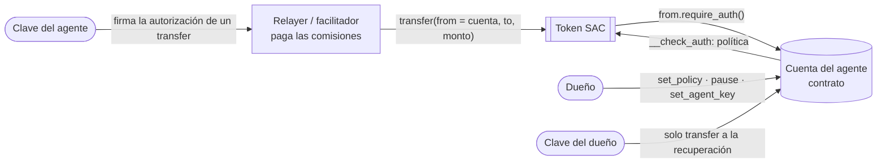

# Arquitectura B: la wallet del agente como cuenta-contrato (prototipo)

> Estado: **prototipo probado en testnet, sin auditar.** Demuestra que una cuenta-contrato puede aplicar la política de CrimsonSentry a cada transferencia del token, con firmas y un host de Soroban reales, y que **el código oficial del facilitador x402 de Stellar acepta y liquida un pago cuyo pagador es esa cuenta**. Lo que no está probado: el cliente oficial de x402 (no sabe firmar para cuentas-contrato), el facilitador alojado y un flujo HTTP completo. Ver [x402](#x402).

## Por qué existe

En la arquitectura A (el vault) el agente llama a `pay` y el dinero vive en el vault. Si el agente tiene saldo propio, puede pagar sin pasar por el vault, y los protocolos x402 y MPP firman **un `transfer` desde la cuenta del agente**, no una llamada al vault. Por eso la A no los intercepta.

La B convierte la propia cuenta del agente en un contrato. El dinero vive en la cuenta, y cuando alguien intenta mover algo, el host de Soroban llama a su `__check_auth`, que decide con la política. No hay un camino "por fuera": toda transferencia desde esa cuenta pasa por la política.



## Cómo decide `__check_auth`

El contrato está en [`contracts/agent-account`](../contracts/agent-account/src/lib.rs). Tiene dos firmantes, y el campo de firma de la entrada de autorización lleva uno de dos valores (`Agent` u `Owner`):

| Firmante | Qué puede autorizar | Qué rechaza |
|---|---|---|
| **Clave del agente** | Únicamente `transfer(from = esta cuenta, to, monto)` del token configurado, si la política lo permite: allowlist, mínimo, límite por pago, límite en 24 h móviles, máximo de pagos y no pausado | Cualquier otra función (por ejemplo `approve`, que dejaría a un tercero vaciar la cuenta), otro contrato, crear contratos, o un `transfer` cuyo origen no sea esta cuenta |
| **Clave del dueño** | Únicamente un `transfer` a la dirección de recuperación fijada al desplegar, aunque esté en pausa | Todo lo demás |

La política, los techos inmutables y la dirección de recuperación funcionan como en el [vault v2](V2.md). Las funciones de administración (`set_policy`, `pause`, `unpause`, `set_agent_key`) exigen la autorización de la dirección del dueño. Los errores usan los mismos números que el vault, más `#15` (llamada no soportada), `#16` (origen que no es la cuenta) y `#17` (el dueño intentó mover fondos fuera de la recuperación).

Decisiones de diseño:

- **Falla cerrado.** Un argumento que no se puede leer, un destino multiplexado o una llamada desconocida se rechazan.
- **Todo el contexto cuenta.** Si una autorización trae varias transferencias, se suman todas y, si alguna falla, no se registra ninguna.
- **El estado se actualiza en `__check_auth`.** La ventana de 24 h se escribe al autorizar, igual que hace la política de límite de gasto de OpenZeppelin.
- **La repetición la evita el host:** el nonce y la expiración forman parte del payload que se firma.

## Evidencia

Cuenta [`CBVCNZYO…KWTJ`](https://stellar.expert/explorer/testnet/contract/CBVCNZYOHMOW3WLUKHEND3FXUOBGTFRZUVGDDB7NLEIYSP37GDEPKWTJ), con un relayer propio que paga las comisiones. Todo en [`evidence/agent-account/testnet-evidence.md`](../evidence/agent-account/testnet-evidence.md):

- ✅ Pago válido de 8 XLM, firmado por el agente.
- 🛑 Fuera de la política, con la autorización real (modo `enforce`): `#1`, `#12`, `#2`; y `#17` para la clave del dueño hacia un destino que no es la recuperación.
- ⛔ Un pago que pasó la simulación y se envía cuando la política ya no lo permite: **falla on-chain** con `#1`.
- ⛔ **Ataque de pagos paralelos:** el pago A pasa y el **B revierte on-chain con `#3`**, como en el vault.
- ✅ La clave del dueño mueve fondos a la dirección de recuperación.
- 🛑 Con la cuenta en pausa, el pago se rechaza (`#7`).

Se reproduce con:

```bash
node tools/agent-account/demo.js init        # claves de prueba desechables y un relayer fondeado
bash scripts/deploy-account.sh
bash scripts/demo-account.sh

# x402: una cuenta limpia, y el cliente y el facilitador oficial en local
ACCOUNT_ALIAS=crimson-agent-account-x402 OUT=evidence/agent-account/x402-deployment.env bash scripts/deploy-account.sh
cd tools/agent-account/x402 && npm install && node e2e.mjs
```

El agente, el dueño y el relayer de esta demo son claves **desechables de testnet**, generadas en `tools/agent-account/.keys.json` (ignorado por Git). No tocan el almacén de claves de Stellar CLI.

## x402

Prueba de extremo a extremo en testnet, en [`evidence/agent-account/x402-evidence.md`](../evidence/agent-account/x402-evidence.md):

- **Cliente:** [`tools/agent-account/x402/client.mjs`](../tools/agent-account/x402/client.mjs), una copia del cliente oficial de `@x402/stellar` (Apache-2.0) que firma la entrada de autorización con la firma propia de la cuenta.
- **Facilitador:** `ExactStellarScheme` de `@x402/stellar/exact/facilitator` 2.20, **sin modificar**, ejecutado en local con el relayer como firmante (paga las comisiones y gasta el número de secuencia, como hace un facilitador real).
- **Resultado:** `verify` válido con la cuenta-contrato como pagador y `settle` correcto en testnet ([`80cc4c7a…`](https://stellar.expert/explorer/testnet/tx/80cc4c7ae7e88796405e0578dfb5ce4ca1858cf38b4623f3c2713961ce44f368)). Un pago de 15 XLM y uno firmado con la clave del dueño hacia el comercio los rechaza la cuenta (`#2` y `#17`) antes de llegar al facilitador.

Lo que se comprobó al leer la [especificación del esquema `exact` de Stellar](https://github.com/coinbase/x402/blob/main/specs/schemes/exact/scheme_exact_stellar.md) y el código de `@x402/stellar`:

- El cliente arma una transacción con **una** operación `invokeHostFunction` que llama a `transfer(from, to, amount)`, la simula y **firma solo las entradas de autorización**. El facilitador sustituye la fuente por la suya.
- La especificación dice que esta firma «admite cuentas C y cuentas G». El facilitador exige que la entrada del pagador esté firmada y que la simulación contra el estado actual tenga éxito; con una cuenta-contrato, esa simulación ejecuta `__check_auth`, así que la política se aplica también ahí.

Hallazgos:

1. **El cliente oficial no firma para cuentas-contrato.** Con una dirección `C…` falla con `invalid version byte` porque el SDK construye una firma clásica a partir de la dirección. El adaptador evita eso con una `authorizeEntry` propia. Lo ideal sería que el cliente oficial admitiera firmas personalizadas.
2. **El pago cuesta mucho más.** La comisión de recursos de la simulación es de unos 286 000 stroops (la primera vez que una cuenta paga, unos 647 000, por crear el registro de gastos), frente a 11 700 de una transferencia clásica. **El tope por defecto del facilitador (50 000 stroops) rechaza el pago.** Hay que subirlo, y en pagos pequeños la comisión puede superar el monto. Se podría reducir optimizando el contrato; no se intentó.
3. **Las credenciales que devuelve hoy la simulación son las clásicas** (`sorobanCredentialsAddress`). El adaptador no maneja la variante V2 que la especificación pide aceptar.

Lo que **no** está resuelto:

- No se probó con el **facilitador alojado** (puede imponer otras reglas) ni con un **servidor HTTP** de recursos (402, reintento, 200). Se probó la parte específica de Stellar: el pago, su verificación y su liquidación.
- Se pagó en **XLM nativo**. x402 usa USDC por defecto: la cuenta puede tener un saldo SAC sin trustline, pero el comercio que recibe sí necesita la suya.
- **Un solo token por cuenta.**
- Las **wallets** tendrían que saber firmar el formato propio de esta cuenta.

## Límites y riesgos

- Prototipo de testnet, **sin auditoría independiente**.
- La cuenta es inmutable, como el vault: un bug obliga a desplegar una nueva y migrar.
- La clave del agente se guarda fuera de la cadena: si se compromete, el atacante puede gastar dentro de la política hasta que el dueño la rote o pause. Los techos no cambian nada de eso.
- La clave del dueño puede mover todo, pero solo a la dirección de recuperación, y puede aflojar la política dentro de los techos, como en el vault.
- El registro de pagos tiene el mismo tope que en el vault (100 entradas).
- La lógica de la política está duplicada respecto al vault. Una versión definitiva debería compartirla en una biblioteca, o expresarse como una política de las cuentas inteligentes de OpenZeppelin (ver [POSICIONAMIENTO.md](POSICIONAMIENTO.md)).

## Pruebas

22 tests en `contracts/agent-account/src/test.rs`, con firmas ed25519 reales y `try_invoke_contract_check_auth`, la forma que ofrece el SDK de probar una cuenta personalizada: política, ventana móvil, varias transferencias en una autorización, llamadas no soportadas, firma incorrecta, firma del dueño usada como la del agente, ruta de recuperación, pausa, rotación de clave y constructor.
