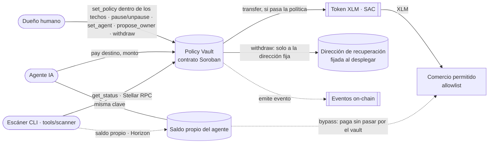
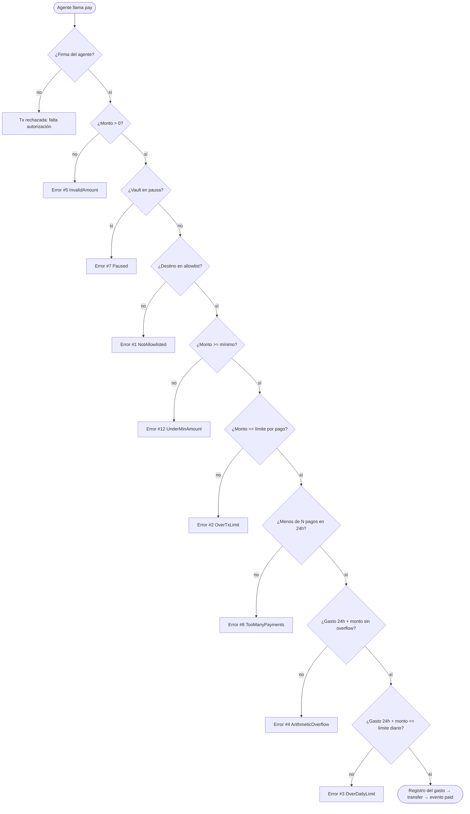
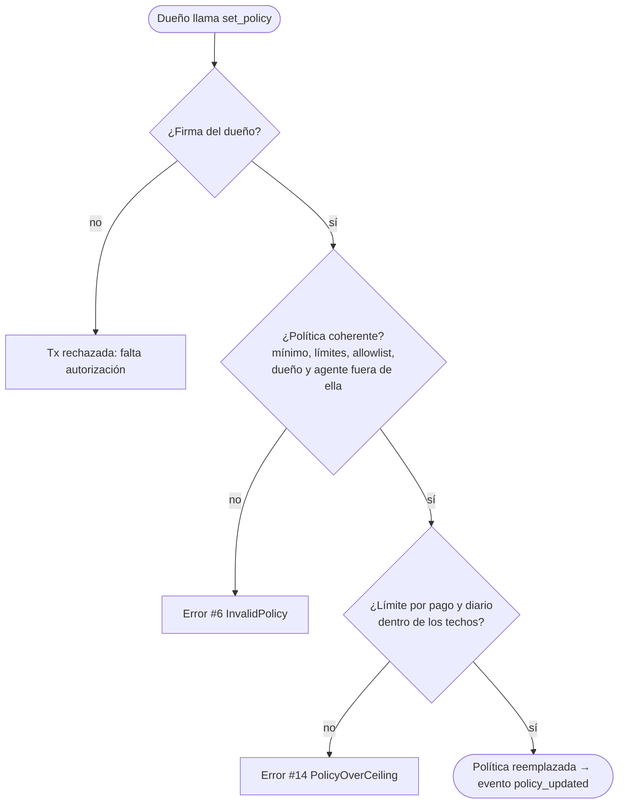

# CrimsonSentry — Arquitectura

Esquema del contrato `policy-vault` **v2**, la versión oficial: 37 tests y `cargo scout-audit` sin hallazgos críticos. La v1 del hackathon tenía 19 tests; los cambios están en [V2.md](V2.md).

## Actores y componentes

## Flujo de validación de `pay()` (en el orden exacto del código)

Cualquier error hace `panic_with_error!` y **revierte toda la transacción**: no se registra el gasto ni se mueve dinero.

## Lo que controla el dueño

Los techos y la dirección de recuperación se fijan en el constructor y no tienen ninguna función que los cambie. `withdraw(amount)` solo paga a la dirección de recuperación. El cambio de dueño es en dos pasos: `propose_owner`, y luego `accept_owner` con la firma de la dirección nueva.

## Opción A (el vault) vs Opción B (la cuenta del agente)

La B tiene un prototipo probado en testnet: ver [ARQUITECTURA-B.md](ARQUITECTURA-B.md).

| | Opción A — el vault (oficial) | Opción B — la cuenta del agente (prototipo) |
|---|---|---|
| Custodia de fondos | El vault retiene el dinero | La wallet del agente, convertida en *contract account* |
| Enforcement | Lógica del contrato en `pay()` | `__check_auth()` en cada firma |
| Compatible con x402 / MPP | ❌ (firman fuera del vault) | ✅ en testnet, con un cliente adaptado: ver [ARQUITECTURA-B.md](ARQUITECTURA-B.md) |
| Punto débil conocido | Si el agente tiene saldo propio, puede evadir el vault | Cada pago cuesta unas 25 veces más en comisiones; sin auditar |

Ese punto débil de la Opción A es justo lo que detecta el escáner (`tools/scanner`, chequeos C1 y C10): lee `get_status()` del vault vía Stellar RPC y el saldo propio del agente vía Horizon. Sobre el vault v1 del hackathon dio 🔴 en C1 mientras la cuenta del agente conservaba sus XLM de Friendbot; desde el 06/10/2026, tras devolver el excedente al dueño, da 🟢. El vault v2 oficial da 🟢 en C1 con su agente de demostración.
